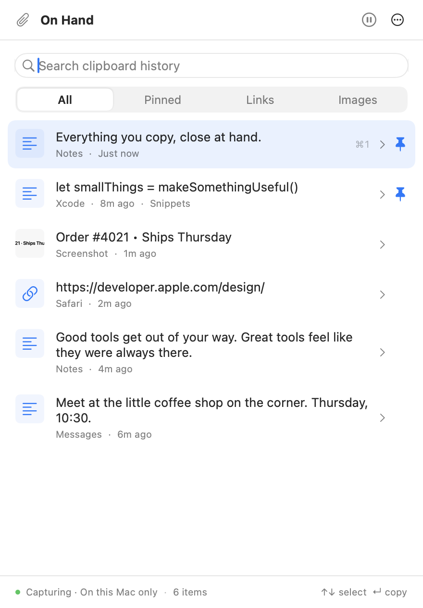
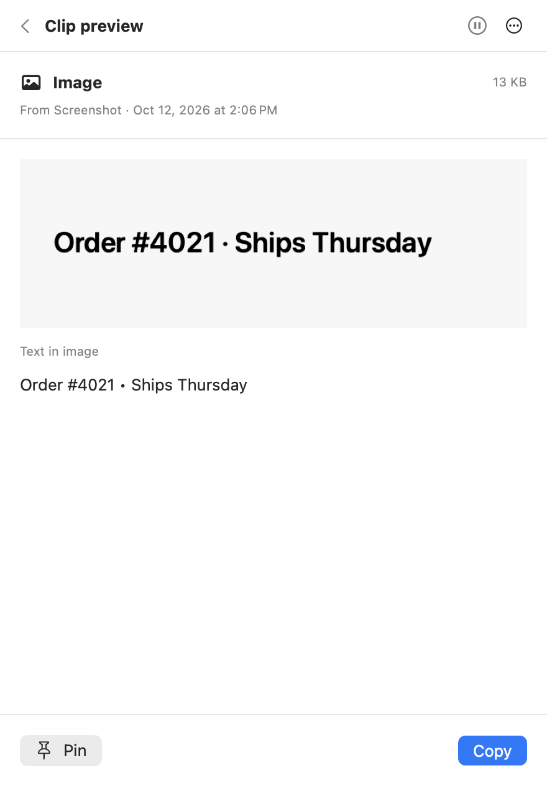
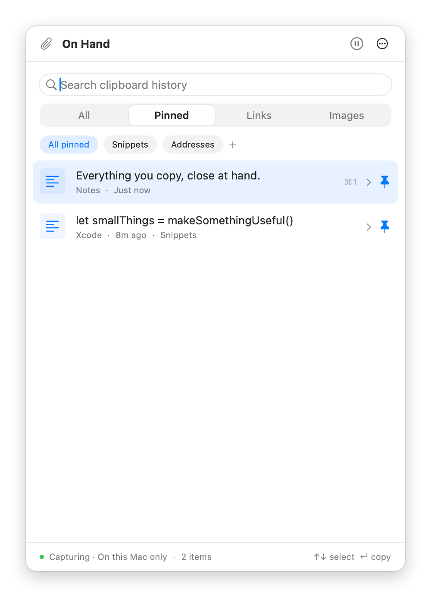

# On Hand

**Copy it once. Find it again.** On Hand is a free, open-source clipboard manager for Mac. It remembers the text, links, and images you copy, so you can search for them later and copy them back, and it keeps everything on your Mac.

<p align="center">
  
</p>

- **Search everything you copied**, including the text inside screenshots.
- **Pin what you reuse** and group pins into boards, like Snippets or Addresses.
- **Keyboard first:** open history from any app with ⌘⇧Space.
- **Private by default:** no account, no sync, no analytics. Card numbers, Social Security numbers, and secret keys are never saved.

[Website](https://onhandformac.com) · [Download](https://onhandformac.com/download) · [Releases](https://github.com/coreyhaines31/onhand/releases)

## Requirements

macOS 14 Sonoma or later, on Apple silicon or Intel.

## Install

**Download:** get the latest release from [onhandformac.com](https://onhandformac.com/download), unzip it, and move **On Hand.app** to your Applications folder. The app is signed and notarized by Apple.

**Homebrew:**

```sh
brew install --cask coreyhaines31/tap/onhand
```

On Hand updates itself. Check anytime from ⋯ › Settings › Check for updates.

## Getting started

1. **Open On Hand** from Applications. A paperclip appears in your menu bar and the history window opens.
2. **Choose "Start keeping my clipboard."** On Hand only saves things you copy from now on. It never imports what was on your clipboard before.
3. **Copy something** in any app, the way you normally would.
4. **Press ⌘⇧Space** (or click the paperclip) to open your history. Type to search, then press Return to copy a clip back.
5. **Paste with ⌘V** in the app you're working in. On Hand switches you back to it automatically.

To have On Hand start with your Mac, turn on **Launch at login** in Settings.

## Everyday use

| Shortcut | What it does |
|---|---|
| ⌘⇧Space | Open or close history from any app (change it in Settings) |
| ↑ ↓, then Return | Select a clip and copy it |
| ⌘1–⌘9 | Copy one of the first nine results |
| ⌘F | Search |
| ⌘O | Preview the selected clip |
| ⌘P | Pin or unpin the selected clip |
| Esc | Leave a preview, or close history |
| ⌃⌥⌘⌫ | Forget your last copy: deletes it from history and clears the clipboard |

- **Filter** with the All, Pinned, Links, and Images tabs.
- **Pin to a board:** right-click a clip and choose **Pin to Board**. Under **Pinned**, click a board to see just its clips. Pinned clips never expire.
- **Find a screenshot by its text:** search for any word in it. Preview an image to select and copy its text.
- **Copy several clips into another app:** turn on ⋯ › **Keep Window Open While Switching Apps**.
- **Delete a clip:** right-click it and choose **Delete**.
- **Pause capture** with the pause button in the header before copying something private.

<p align="center">
  
  &nbsp;
  
</p>

## Privacy

- **Everything stays on your Mac.** History is a local database in `~/Library/Application Support/OnHand`. Nothing is uploaded, and the app has no analytics. Text in images is recognized on your Mac with Apple's Vision framework.
- **Sensitive copies are skipped.** On Hand ignores clipboard items that apps mark as concealed or temporary. It also excludes 1Password, Bitwarden, Apple Passwords, Dashlane, and LastPass by default, and doesn't save card numbers, US Social Security numbers, or common secret keys, including ones inside screenshots.
- **These checks can't catch everything.** Addresses, passwords you type yourself, and other private details can still be saved. Pause capture first, or press ⌃⌥⌘⌫ to forget a copy.
- **You control retention.** Unpinned clips expire after 7 days by default; choose 1, 7, 30, or 90 days in Settings. History holds up to 500 clips or 50 MB.

Read the full [privacy policy](https://onhandformac.com/privacy).

## Troubleshooting

**Nothing new shows up in history.** Check whether capture is paused: a banner says so under the search field. Click **Resume**. Copies from excluded apps (Settings › Privacy) and copied files are never saved.

**⌘⇧Space doesn't open On Hand.** Another app may use the same shortcut. Pick a different one in Settings › Open On Hand.

**macOS asks whether On Hand can paste from other apps.** Choose **Allow**. On Hand needs to read the clipboard to save your history. You can change this later in System Settings › Privacy & Security.

**I can't see the paperclip in the menu bar.** Your menu bar may be full or hiding icons. Press ⌘⇧Space instead, or open On Hand again from Applications.

**A copy I expected was skipped.** On Hand skips text over 1 MB, images over 10 MB, and anything that looks like a card number, Social Security number, or secret key. The menu bar icon briefly shows a raised hand when it skips one of those. You can turn this off in Settings › Privacy.

Something else? [Open an issue](https://github.com/coreyhaines31/onhand/issues/new/choose). Please describe the problem without pasting your real clipboard history.

## Uninstall

Quit On Hand from ⋯ › Settings, then drag **On Hand.app** to the Trash. To also delete your history and settings, remove:

```
~/Library/Application Support/OnHand
~/Library/Preferences/com.onhandformac.OnHand.plist
```

With Homebrew, `brew uninstall --zap --cask onhand` does all of this.

## Build from source

You need macOS 14+, Xcode 16 or later, and [Homebrew](https://brew.sh).

```sh
git clone https://github.com/coreyhaines31/onhand.git
cd onhand
brew install xcodegen swiftlint
make app
open "dist/On Hand.app"
```

See [CONTRIBUTING.md](CONTRIBUTING.md) for tests, project layout, and how to submit changes.

## License

[MIT](LICENSE). Free to use, modify, and share.
